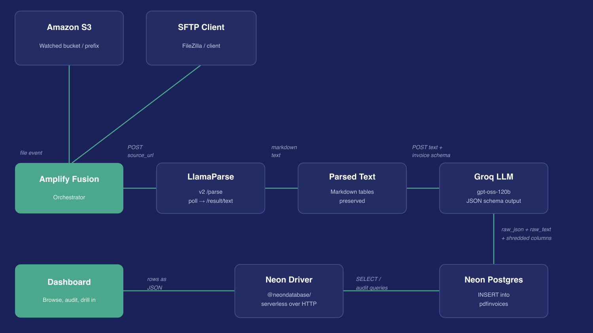
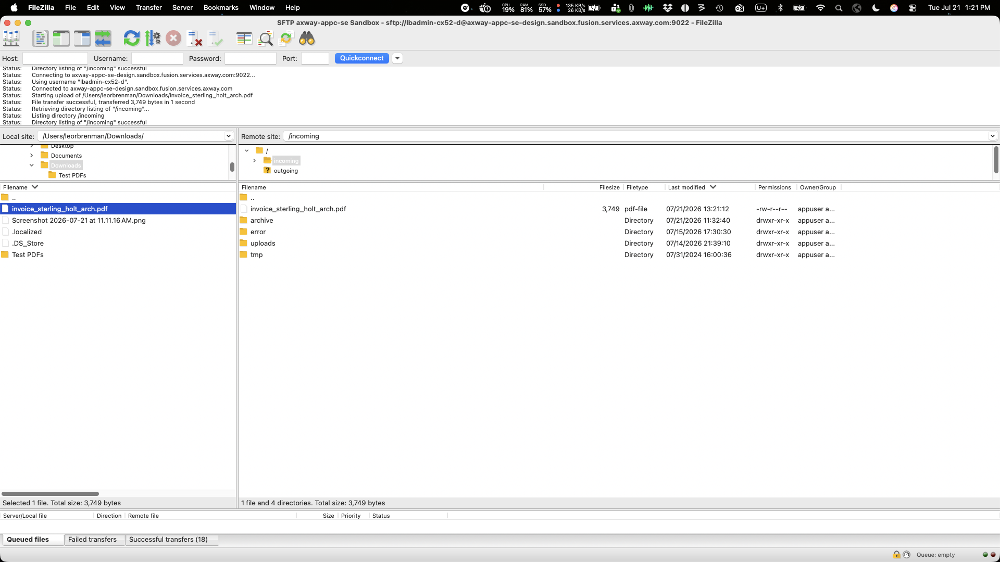
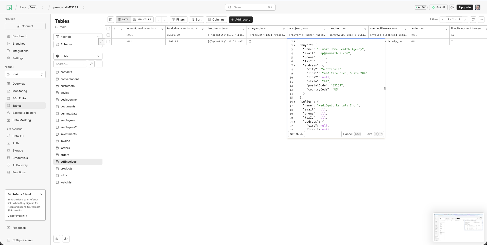
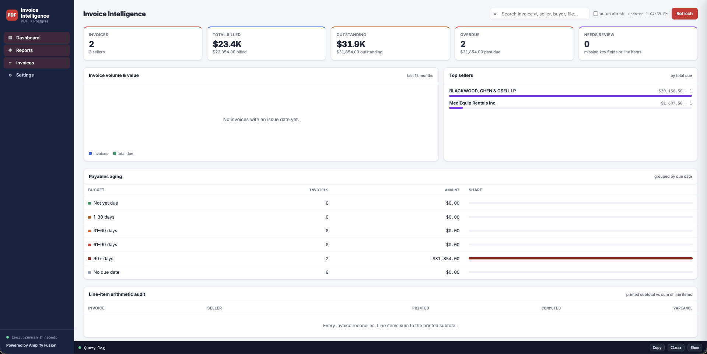
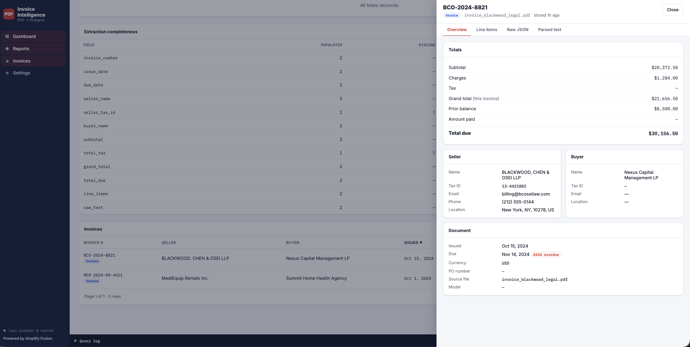

# Amplify Fusion - PDF Invoice Processor

An Amplify Fusion PDF Invoice Processor demonstration. This project demonstrates an end-to-end pipeline for automatically extracting structured data from PDF invoices eliminating manual data entry and enabling downstream automation. Specifically inserting into a Database.

* [Demo Video]()
* [How It Was Built Video]()

PDF documents are ingested via S3 or SFTP and orchestrated by Axway Amplify Fusion, which manages the multi-step flow. LlamaParse handles the first stage — converting raw PDF files into clean, readable text. This is a deliberate architectural decision: PDF-to-text extraction is a hard problem on its own, involving layout parsing, table reconstruction, and OCR for scanned documents. LlamaParse is purpose-built for this, using vision-language models to preserve document structure in a way that generic text extraction cannot.

Once clean text is available, it is passed to the LLM for structured extraction and conversion to a JSON schema. This separation is intentional — by the time the LLM receives the input, it is working with clean, well-formed text rather than raw PDF bytes. The LLM is then free to focus entirely on understanding the document semantics: what type of document is it, who are the parties, what are the key fields, and how do they map to the predefined JSON schema. The result is a strongly-typed JSON blob that is inserted directly into a PostgreSQL database alongside mainly scalar fields for efficient invoice querying.

  

Major Steps are:

* Invoice PDF files are ingested by SFTP OR S3 SQS listener
* PDF is converted to text using [LlamaParse](https://www.llamaindex.ai/)
* Text converted to predefined schema by a [Groq](https://groq.com/) `gpt-oss-120b` LLM using the Fusion OpenAI Connector
* Structured data is inserted into a [Neon Postgres](https://neon.com/) database for reporting and downstream processing/usage

The Fusion project export, LLM prompt, schema, user massage template and test PDF sample files are all incuded.

A web based dashboard for viewing the structured results in Postgres is included in the project and exposed using an HTTP Server integration called `webapp`.

An embedded web app for viewing the structured Postgres data is included in the project in the HTTP Server webapp integration.

This project is similar and related to the [Amplify Fusion - Unstructured to Structured Classifier](https://github.com/lbrenman/Amplify-Fusion-Unstructured-to-Structured-Classifer).

## How to Use

* Download repo
* Import the `PDFInvoiceProcessor.zip` project export into your Fusion tenant
* Configure connection with your credentials for LlamaParse, Neon Postgres, AWS S3 and AWS SQS
* Set Postgres Table using SQL below
* Use an SFTP client such FileZilla to upload pdf invoices to Fusion or upload pdf invoices to an S3 Bucket that triggers an SQS message

## Postgres DB

* Create the Postgres database table as follows:

    ```sql
    CREATE TABLE IF NOT EXISTS pdfinvoices (
        id                      BIGSERIAL PRIMARY KEY,

        -- ---- Identifiers -------------------------------------------------------
        invoice_number          TEXT        NOT NULL,
        invoice_type            TEXT        NOT NULL DEFAULT 'invoice',
        purchase_order_number   TEXT,

        -- ---- Dates -------------------------------------------------------------
        issue_date              DATE,
        due_date                DATE,

        -- ---- Currency ----------------------------------------------------------
        currency                CHAR(3),

        -- ---- Seller (flattened for querying) -----------------------------------
        seller_name             TEXT,
        seller_tax_id           TEXT,
        seller_email            TEXT,
        seller_phone            TEXT,
        seller_city             TEXT,
        seller_state            TEXT,
        seller_postal_code      TEXT,
        seller_country_code     CHAR(2),

        -- ---- Buyer -------------------------------------------------------------
        buyer_name              TEXT,
        buyer_tax_id            TEXT,
        buyer_email             TEXT,
        buyer_city              TEXT,
        buyer_state             TEXT,
        buyer_postal_code       TEXT,
        buyer_country_code      CHAR(2),

        -- ---- Totals ------------------------------------------------------------
        subtotal                NUMERIC(18,2),
        total_charges           NUMERIC(18,2),
        total_tax               NUMERIC(18,2),
        grand_total             NUMERIC(18,2),
        prior_balance           NUMERIC(18,2),
        amount_paid             NUMERIC(18,2),
        total_due               NUMERIC(18,2),

        -- ---- Nested structures -------------------------------------------------
        line_items              JSONB       NOT NULL DEFAULT '[]'::jsonb,
        charges                 JSONB       NOT NULL DEFAULT '[]'::jsonb,

        -- ---- Provenance --------------------------------------------------------
        raw_json                JSONB       NOT NULL,   -- full LLM response
        raw_text                TEXT,                   -- LlamaParse output
        source_filename         TEXT,
        model                   TEXT,

        -- ---- Housekeeping ------------------------------------------------------
        line_item_count         INTEGER GENERATED ALWAYS AS (jsonb_array_length(line_items)) STORED,
        created_at              TIMESTAMPTZ NOT NULL DEFAULT now(),
        updated_at              TIMESTAMPTZ NOT NULL DEFAULT now(),

        CONSTRAINT pdfinvoices_line_items_is_array CHECK (jsonb_typeof(line_items) = 'array'),
        CONSTRAINT pdfinvoices_charges_is_array    CHECK (jsonb_typeof(charges) = 'array')
    );

    CREATE UNIQUE INDEX IF NOT EXISTS pdfinvoices_seller_number_uq
        ON pdfinvoices (seller_name, invoice_number);

    CREATE INDEX IF NOT EXISTS pdfinvoices_issue_date_idx   ON pdfinvoices (issue_date DESC);
    CREATE INDEX IF NOT EXISTS pdfinvoices_due_date_idx     ON pdfinvoices (due_date);
    CREATE INDEX IF NOT EXISTS pdfinvoices_buyer_name_idx   ON pdfinvoices (buyer_name);
    CREATE INDEX IF NOT EXISTS pdfinvoices_raw_json_gin     ON pdfinvoices USING GIN (raw_json jsonb_path_ops);
    CREATE INDEX IF NOT EXISTS pdfinvoices_line_items_gin   ON pdfinvoices USING GIN (line_items jsonb_path_ops);

    -- Keep updated_at honest.
    CREATE OR REPLACE FUNCTION set_pdfinvoices_updated_at() RETURNS TRIGGER AS $$
    BEGIN
        NEW.updated_at = now();
        RETURN NEW;
    END;
    $$ LANGUAGE plpgsql;

    DROP TRIGGER IF EXISTS pdfinvoices_set_updated_at ON pdfinvoices;
    CREATE TRIGGER pdfinvoices_set_updated_at
        BEFORE UPDATE ON pdfinvoices
        FOR EACH ROW EXECUTE FUNCTION set_pdfinvoices_updated_at();
    ```

## Screen Shots

* Upload File

  

* Data extracted, parsed and inserted into Postgres

  

* View in Dashboard

  
  